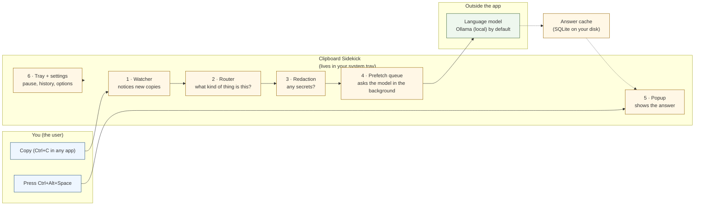
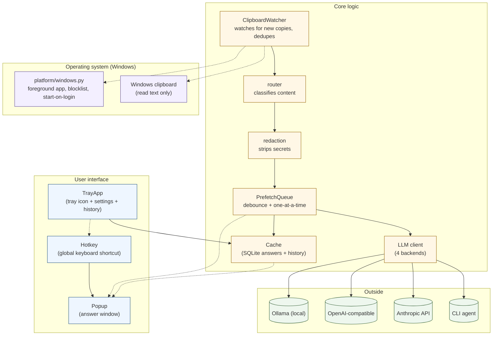
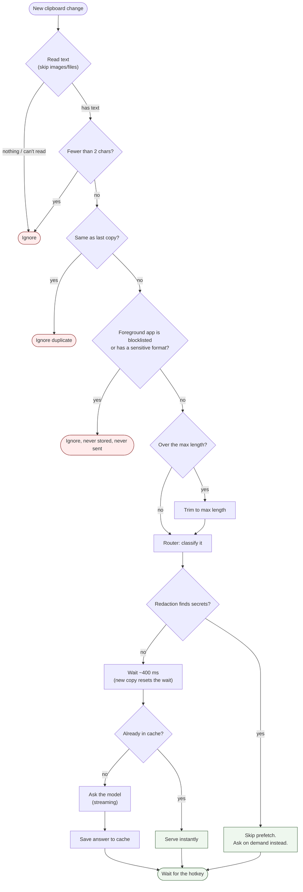
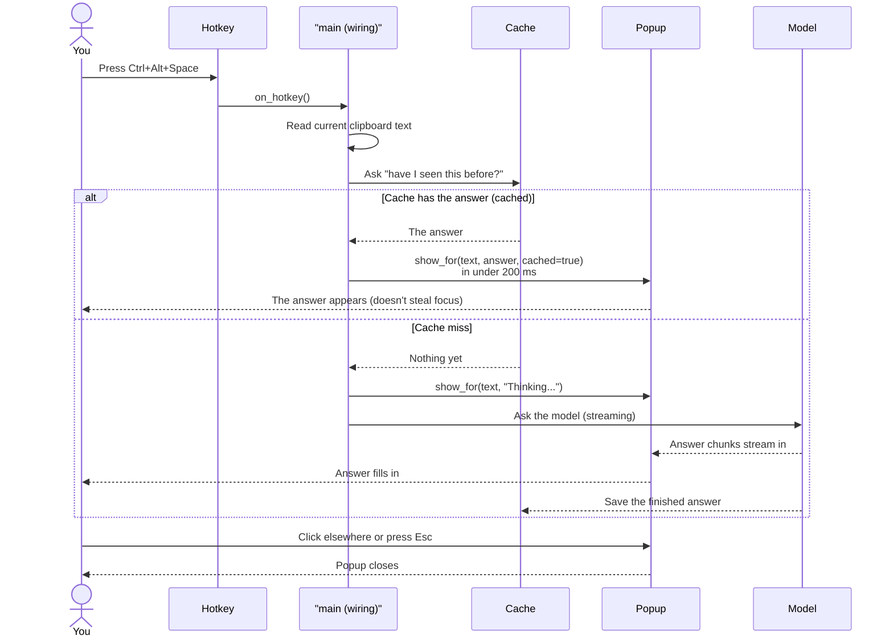
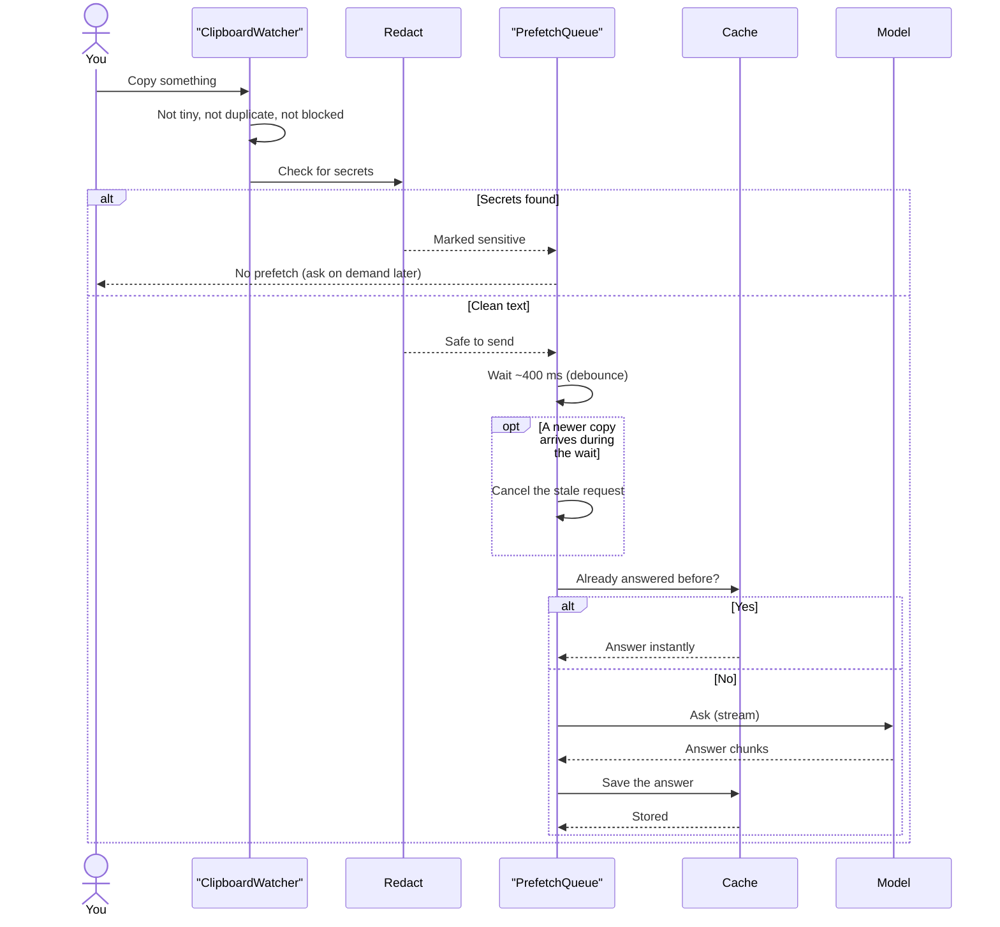
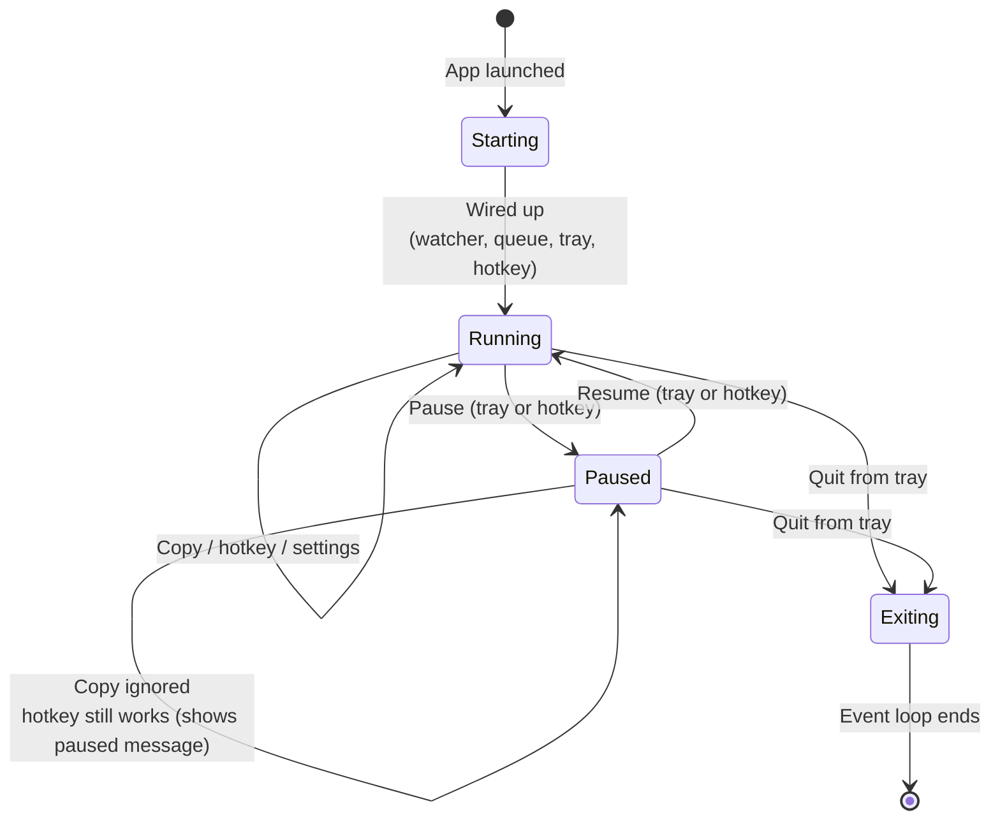
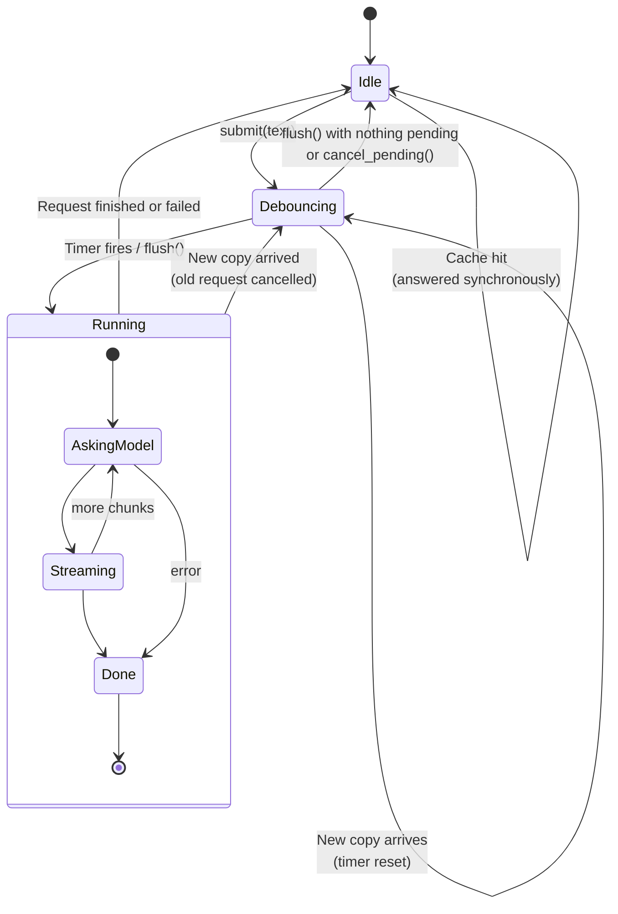
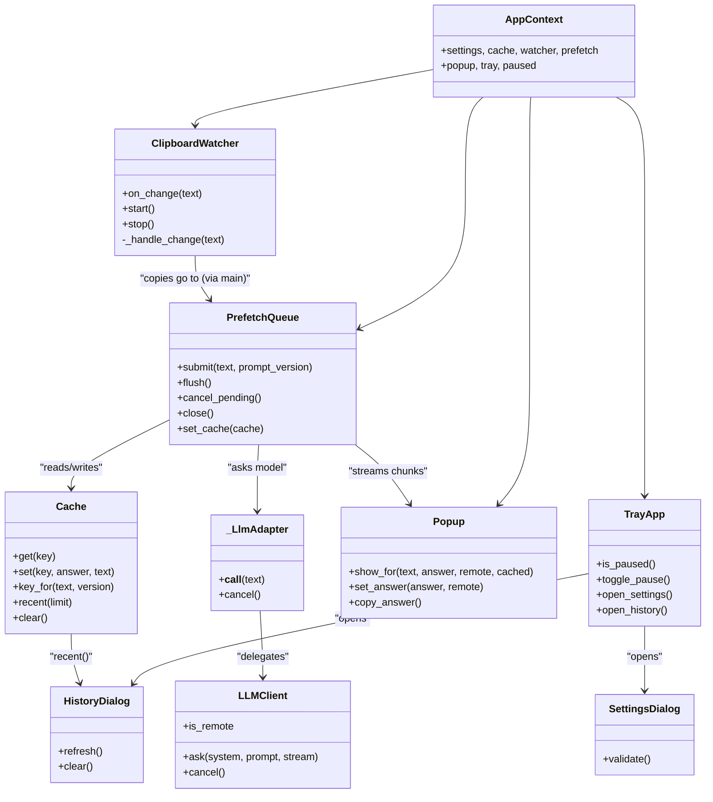
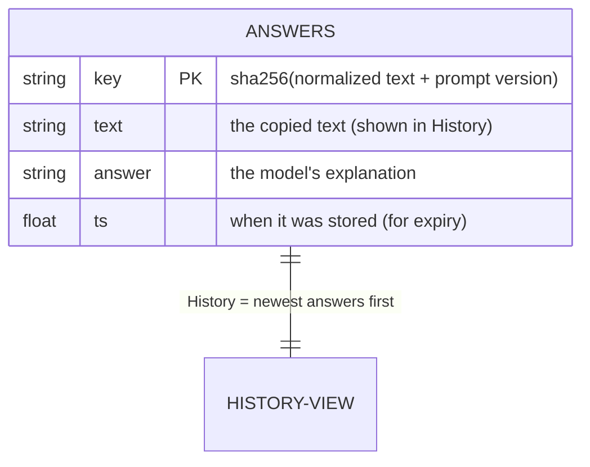
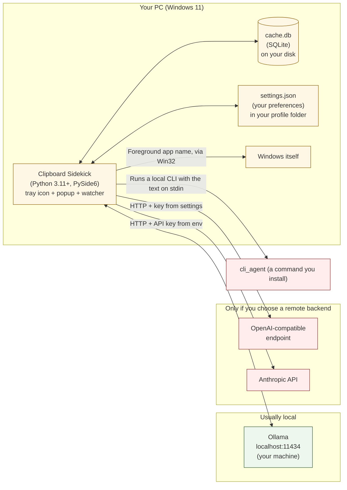

# Clipboard Sidekick Architecture

This document explains how the app is put together for readers who do not write code for a living. Each section opens with a short answer in plain words, and the diagram underneath shows the detail. All diagrams are [Mermaid](https://mermaid.js.org) and render on GitHub.

| Diagram | What it shows | Go to |
|---|---|---|
| 1. At a glance | Where everything sits, in the big picture | [§1](#1-at-a-glance) |
| 2. Component diagram | The big boxes and what each one does | [§2](#2-component-diagram) |
| 3. Copy flow (flowchart) | Every filter a copy passes through, and what happens at each one | [§3](#3-copy-flow-flowchart) |
| 4. Hotkey flow (sequence diagram) | Who talks to whom when you press Ctrl+Alt+Space | [§4](#4-hotkey-flow-sequence-diagram) |
| 5. Prefetch flow (sequence diagram) | How the app guesses what you copied before you ask | [§5](#5-prefetch-flow-sequence-diagram) |
| 6. App lifecycle (state diagram) | What states the app can be in (paused, running, etc.) | [§6](#6-app-lifecycle-state-diagram) |
| 7. Prefetch queue (state diagram) | How the queue keeps at most one request in flight | [§7](#7-prefetch-queue-state-diagram) |
| 8. Class diagram | The main pieces of code and how they relate | [§8](#8-class-diagram) |
| 9. Data model (ER diagram) | What gets stored on disk, and how | [§9](#9-data-model-er-diagram) |
| 10. Deployment diagram | Where it runs, what talks to what over the network | [§10](#10-deployment-diagram) |

## 1. At a glance

The app sits between your clipboard and a language model. It watches for new copies, drops anything noisy or secret, and shows a short explanation when you ask.

A copy triggers the watcher, the watcher narrows it down, the queue asks the model, and the popup waits for your hotkey. That is the whole loop.

## 2. Component diagram

Nine parts cooperate, and each one has a single job. That isolation makes failures easy to locate.

| Box | Plain-language job |
|---|---|
| **ClipboardWatcher** | Voids (ignores) blank copies, repeats, and crazy-long ones. |
| **router** | Looks at the text and says "this is a word / an error / code / a URL / long text / a number / something else." |
| **redaction** | Looks for secrets and masks them before anything leaves the machine. |
| **PrefetchQueue** | Waits ~400 ms (a burst of copies usually means you're done), then asks the model, one question at a time. |
| **Cache** | Remembers answers on disk so a repeat copy answers instantly next time. |
| **LLM client** | Talks to Ollama (default, local), an OpenAI-compatible endpoint, Anthropic's API, or a command-line agent. |
| **Popup / TrayApp / Hotkey** | The parts you see and touch. |
| **platform/windows.py** | Asks Windows "which app is in front right now?" so copies from password managers can be skipped. |

## 3. Copy flow (flowchart)

A copy passes six gates before it reaches the model.

The gates keep noise out and secrets in. Blank or repeated copies are noise. Blocked apps are password managers and similar tools whose text should never be stored. Redaction is the safety net that stops a pasted API key from reaching a cloud model.

## 4. Hotkey flow (sequence diagram)

When you press the hotkey, the popup answers from memory if it can and asks the model otherwise. It never takes keyboard focus.

The popup leaves your keyboard alone, so you can keep typing in your editor. The cached path does no network work, which is why it stays fast.

## 5. Prefetch flow (sequence diagram)

Every accepted copy starts a background request, so the answer is usually ready before you press the hotkey.

The 400 ms pause does most of the work. Copy three things in a row and only the last one gets asked about. The queue also keeps one request in flight, and a new copy cancels the previous request before starting another.

## 6. App lifecycle (state diagram)

The app is either running or paused. You can switch at any time, even while a request is in flight.

Pause works even mid-request because pausing is a flag on the wiring layer, not a dependency on the model or the watcher. While paused, copies are dropped without storage or requests, and the hotkey shows the paused message.

## 7. Prefetch queue (state diagram)

The queue has five states. The rule that matters is one request at a time.

`Idle` means nothing is happening, `Debouncing` means the queue is waiting ~400 ms, and `Running` means it is asking the model. A new copy during `Debouncing` restarts the wait. A new copy during `Running` cancels the old request first. A cache hit skips all three and answers instantly from `Idle`.

## 8. Class diagram

This diagram is for developers: the main classes, their important methods, and the calls between them.

`main.py` builds one `AppContext` that owns a single instance of each piece. The watcher feeds the queue, the queue feeds the cache and the model, and the popup displays whatever the queue produces.

## 9. Data model (ER diagram)

One SQLite table stores answers and the text they belong to, so History can show both.

The key is a fingerprint of the text, so the same text always finds its answer again even when whitespace differs. Rows older than `cache_expiry_days` (default 30) are pruned automatically. "Clear history" deletes every row. Nothing else is written to disk: no cloud sync, no telemetry, and no log of your copies.

## 10. Deployment diagram

The app runs on your PC. Network traffic goes only to the model backend you choose.

Two deployment facts matter. With the default `ollama` backend, no clipboard content leaves your PC because the model runs on your own machine. Switching to a cloud backend turns on the "Remote backend" indicator in the popup, and secret redaction runs before anything is sent.

## Glossary

| Term | Plain meaning |
|---|---|
| **Hotkey** | A keyboard shortcut that works system-wide (here `Ctrl+Alt+Space`). |
| **Debounce** | Waiting a short quiet period before acting, so a burst of activity results in one action. |
| **Streaming** | The model sends its answer a few words at a time, so the popup fills in progressively. |
| **Cache** | A memory of past answers, so a repeat copy answers instantly. |
| **Redaction** | Blotting out secrets (API keys, passwords, credit-card numbers) with `[REDACTED]`. |
| **Backend** | The engine that produces explanations (Ollama, OpenAI-compatible, Anthropic, a CLI agent). |
| **SQLite** | A tiny database that lives in a single file. |
| **Tray icon** | The small icon in the Windows taskbar notification area. |
| **Start-on-login** | A registry entry under Windows' "Run" key that launches the app when you sign in. |
| **Focus-stealing** | A window grabbing your keyboard so you can't type where you were. The popup deliberately doesn't do this. |

This document describes the implemented code in `clipboard_sidekick/`. If a diagram disagrees with the code, trust the code.
